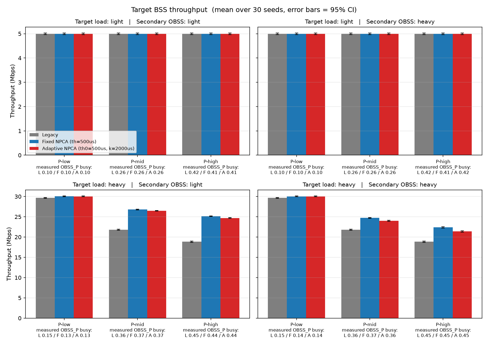
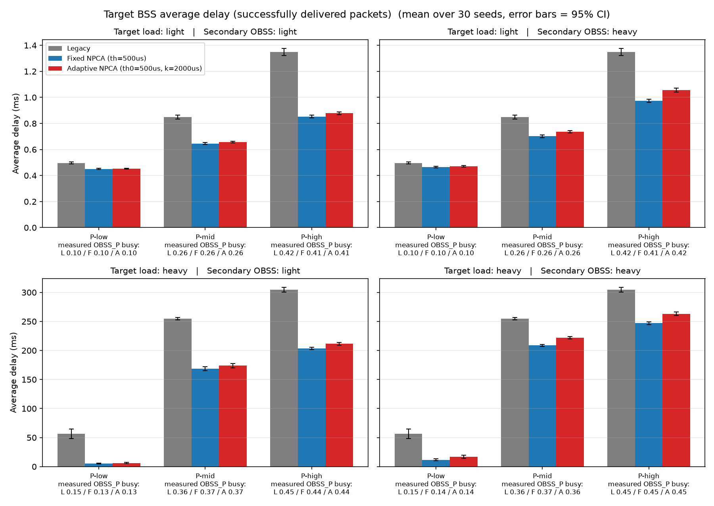

# NPCA（IEEE 802.11bn / Wi-Fi 8）簡化 MAC 離散事件模擬

「高速無線區域網路設計」作業：比較 **Legacy Channel Access**、**固定門檻 NPCA**、**自適應門檻 NPCA** 三種方法對目標 BSS 的吞吐量、延遲與鄰近 BSS 的影響。
所有結果都由本專案程式實際跑出（見最後一節的指令與檔案清單）；改善方法有效、無效或變差，數據一律保留。

---

## 1. 專案結構

| 路徑 | 說明 |
|---|---|
| `npca_sim/config.py` | PHY / MAC 常數、PPDU 傳輸時間公式 |
| `npca_sim/sim.py` | 事件驅動的封包層級 MAC 模擬器（Legacy / 固定 / 自適應共用同一份程式） |
| `npca_sim/traffic.py` | 封包到達序列與退避亂數源（分開的亂數流） |
| `npca_sim/experiment.py` | 單次執行與平行批次執行（標準函式庫 `multiprocessing`） |
| `npca_sim/stats.py` | 平均值、Student t 95% 信賴區間 |
| `npca_sim/scenarios.py` | 情境定義 |
| `validate.py` | 驗證腳本（正式實驗前先跑） |
| `pilot.py` | 試跑：決定 OBSS 低/中/高負載；確認暖機、量測長度、種子數 |
| `run_experiment.py` | 正式實驗、敏感度實驗、事件紀錄片段 |
| `analyze.py` | 彙總 CSV、成對差值、PNG 圖、`results/tables.md` |
| `run_all.ps1` | 依序執行以上全部步驟 |
| `requirements.txt` | 相依套件（固定版本） |
| `results/` | 全部輸出（見第 9 節） |

---

## 2. 環境與重現指令（Windows 10 / PowerShell 5.1）

實測環境：Python **3.11.4**（`C:\Python311`）、`.venv`、NumPy **2.4.6**、Matplotlib **3.11.2**；其餘只用標準函式庫（`heapq`、`bisect`、`random`、`multiprocessing`、`csv`、`json`、`math`、`re`）。機器為 6 核心 CPU，正式流程約 15–20 分鐘（主實驗約 2 分鐘、敏感度約 7 分鐘）。

```powershell
cd C:\Users\user\Desktop\LANHW\HW2
python -m venv .venv                                  # 若 .venv 尚未存在
.\.venv\Scripts\python.exe -m pip install -r requirements.txt
.\.venv\Scripts\python.exe --version                  # Python 3.11.4
.\.venv\Scripts\python.exe -m pip freeze              # 相依套件版本

# 一次重現全部結果
powershell -ExecutionPolicy Bypass -File .\run_all.ps1

# 或逐步執行
.\.venv\Scripts\python.exe validate.py                # 驗證 (結果 -> results/validation_report.txt)
.\.venv\Scripts\python.exe pilot.py load              # Legacy 試跑：選定 OBSS 負載
.\.venv\Scripts\python.exe pilot.py timing            # 暖機 / 量測長度 / 種子數試跑
.\.venv\Scripts\python.exe run_experiment.py main     # 正式實驗
.\.venv\Scripts\python.exe run_experiment.py sens     # 敏感度實驗
.\.venv\Scripts\python.exe run_experiment.py events   # 事件紀錄片段
.\.venv\Scripts\python.exe analyze.py                 # 彙總與繪圖
```

模擬完全由種子決定，重跑得到相同結果（我用單一程序重算 9 次模擬並與平行執行得到的 CSV 逐欄比對，0 個差異）；平行執行只影響完成順序，輸出前已排序。

---

## 3. 文獻依據與本作業假設

參考論文：B. Bellalta, F. Wilhelmi, L. Galati-Giordano, G. Geraci, *Modeling and Performance Analysis of Non-Primary Channel Access in Wi-Fi Networks*, IEEE OJCOMS, 2025, doi:10.1109/OJCOMS.2025.3609964（arXiv:2504.15774）。以下「文獻依據」是我讀該文 Section II–V 後採用的行為；「本作業假設」是我自己加的簡化或設計，**不是**論文的結論。

### 3.1 文獻依據

| 行為 | 論文出處 | 本模擬器對應 |
|---|---|---|
| 偵測到主通道有 OBSS 傳輸後，NPCA 裝置切到預先指定的 20 MHz 副通道競爭 | Sec. II | 切換到副通道 S |
| 副通道競爭在 OBSS 傳輸開始後 `T_NPCA` 才開始；返回主通道需 `T_switch` | Sec. II | `T_OUT`、`T_BACK` |
| NPCA 傳輸必須在 OBSS 傳輸結束前完成（因為 BSS 內不是所有裝置都支援 NPCA）；可用時間 = OBSS 時間 − `T_NPCA` − `T_switch` | Sec. II、IV-B2 | 窗口 `win_end = OBSS 結束 − T_BACK`，起送前檢查整個交換放得下 |
| 切到副通道後若副通道一開始忙碌，繼續監聽，NPCA 機會結束前變閒就可傳 | Sec. II 假設 1 | S 忙時等待，閒置後再感測、倒數 |
| 一次 NPCA 傳輸結束後若時間仍夠，重新 backoff 再傳（multi-NPCA） | Sec. II 假設 2 | 成功/失敗後在窗口內再競爭 |
| 每次傳輸只有一個 backoff 實例；legacy 模式主通道忙時暫停，NPCA 模式只在主、副通道都忙時暫停；同一個 backoff 期間可在兩種模式間多次切換 | Sec. III、IV-D | 單一 backoff 計數器跨通道延用（NPCA 期間主通道必定被該 OBSS 占用，故等同「副通道忙時暫停」） |
| 切換/碰撞後 CW 與 backoff 該如何處理是「尚待定義的開放問題」 | Sec. IV-D | 本作業自訂明確規則（3.3、4.3） |
| slot 9 µs、SIFS 16 µs、DIFS 34 µs（論文 Table I） | Table I | 相同；CWmin=15、CWmax=1023 取標準值（論文模擬器為 15 / 1024） |
| NPCA 對主通道 OBSS「透明」，但會增加副通道競爭、可能影響副通道 BSS | Sec. V-A、V-D | 本作業量測 OBSS_P、OBSS_S 的吞吐量與延遲 |
| NPCA 增益受 OBSS 傳輸長度限制（OBSS 愈長，機會愈大） | Sec. V-B | OBSS PPDU 長度為多值分佈 |

### 3.2 與論文不同之處（本作業簡化）

| 項目 | 論文 | 本作業 |
|---|---|---|
| 方法 | 連續時間 Markov 鏈 + 另一套模擬器 | 自行實作的封包層級離散事件模擬 |
| 流量方向 | 僅下行 | 目標 BSS 為**上行**，多台 STA 競爭 |
| 頻寬 | 80/160 MHz、A-MPDU | **單一 20 MHz**，目標 BSS 每個 PPDU 只含 1 個 MPDU；因此 Legacy 的頻寬擴展（直接用 160 MHz）、通道綁定被簡化掉 |
| 保護機制 | RTS/CTS | 無 RTS/CTS（碰撞要付整個 PPDU 的時間） |
| 錯誤 | PER = 0.1 | 無 PHY 錯誤，失敗只來自同槽碰撞 |
| 切換觸發 | 偵測到 RTS/CTS 後即切；未提門檻 | **門檻規則與自適應門檻是本作業設計**（論文只在 Related Work 提到 TGbn 仍在討論切換條件） |
| `T_NPCA`、`T_switch` | 與 RTS/CTS 時間有關 | 取 `T_OUT`=100 µs、`T_BACK`=50 µs（**假設值**） |

### 3.3 其他本作業假設（全部寫進程式、可在 `npca_sim/config.py`、`sim.py` 查證）

1. 同通道的傳送端彼此完全可感測（無隱藏節點）；目標 AP 與 STA 能零開銷協調一起切換。
2. 所有節點都以「忙碌結束 + DIFS」為原點的 slot 格線倒數，因此同一個 slot 起送才會碰撞，不會出現亞 slot 的先後。
3. 通道忙碌期（成功或碰撞）所有節點都視為忙（等同 NAV），**不使用 EIFS**；ACK timeout = SIFS + ACK 時間，與成功交換同長，因此碰撞忙碌長度 = 最長 PPDU + SIFS + ACK。
4. 碰撞中的 OBSS PPDU 無法解碼，故**不觸發** NPCA；目標 BSS 自己的傳輸也不觸發。
5. 每個隊首封包起送前一律先抽 backoff（含空閒時到達的封包，無立即存取）。
6. 理想歷史觀測：自適應門檻用的「副通道近期忙碌比例」假設目標 AP 持續觀測副通道的 OBSS 活動（即使人在主通道），無額外開銷；詳見 4.4。
7. 緩衝區有限：目標 STA 100 個封包、OBSS 傳送端 50 個封包，滿了就丟棄新到封包（尾端丟棄）。
8. 同一份程式與同一組規則用於 Legacy 與兩個 NPCA 模型；Legacy 只是「永不觸發切換」。

---

## 4. 模型規則

### 4.1 PHY 傳輸時間（三組完全一致）

| 項目 | 值 |
|---|---|
| slot / SIFS / DIFS | 9 / 16 / 34 µs |
| PHY 前導碼 | 40 µs；OFDM 符元 13.6 µs；每符元 1170 bit（HE 20 MHz MCS7、1 SS，約 86 Mbps） |
| ACK（與 Block ACK 同長） | 28 µs |
| 目標 BSS 封包 | 1500 B 資料 + 34 B MAC 開銷 → PPDU 189.6 µs，一次完整交換（PPDU+SIFS+ACK）233.6 µs |
| OBSS PPDU | 聚合 n ∈ {1, 3, 6, 12, 24} 個 MPDU，機率 {0.30, 0.25, 0.20, 0.15, 0.10}；完整交換 233.6 / 519.2 / 954.4 / 1811.2 / 3524.8 µs |
| `T_OUT` / `T_BACK` | 100 / 50 µs |
| 吞吐量 | 只計成功送達的 1500 B 有效資料；延遲 = 封包進入佇列到 ACK 完成 |

### 4.2 共用的存取、碰撞與重傳邏輯

- CWmin 15、CWmax 1023；失敗後 CW ← 2·CW+1（上限 1023）。
- 同槽起送 ≥ 2 個節點 → 全部失敗（碰撞），在 ACK timeout 後各自重抽 backoff。
- **重試上限 7**：第 8 次失敗後丟棄（記為 `drop_retry`），CW 重置；成功後 CW 重置為 15。
- 封包到達時佇列已滿 → 丟棄（`drop_overflow`）。
- 主通道忙碌時 backoff 凍結，恢復閒置並再等 DIFS 後續倒數。
- 亂數：到達（每節點兩條獨立 NumPy 子流：指數間隔、OBSS 大小）與退避（每節點一條 `random.Random`）完全分開。同一 (情境, 種子) 下，三種方法**共用相同的目標 BSS 與兩側 OBSS 到達序列**；不同負載共用同一條單位指數序列，只做縮放。

### 4.3 NPCA 規則（固定門檻、自適應門檻完全相同，只有門檻值不同）

1. **觸發**：主通道出現 OBSS_P 單獨成功的 PPDU（起點 t0）。
2. **判斷時刻** `t = t0 + T_OUT`。**估計剩餘時間** `R = (t0 + PPDU + SIFS + ACK) − t`；PPDU 長度視為由前導碼長度欄位得知，不從事件佇列讀取尚未發生的狀態。
3. **切換條件**：目標 BSS 至少一台 STA 有待傳封包，且 `R > θ`。
   - 固定門檻：`θ = θ0`（主實驗 500 µs）。
   - 自適應門檻：`θ = θ0 + k · r`，`θ0` 與固定組相同（500 µs），`k` = 2000 µs，`r` 見 4.4。`k = 0` 時與固定組逐位元相同（已驗證）。
4. **切出後**：BSS 內所有 STA 一起到副通道 S，先在 S 感測 DIFS 閒置才開始倒數（感測時間已計入）；S 忙碌就等，閒置後再等 DIFS 續倒數，絕不把切換本身算成功傳輸。
5. **窗口**：`win_end = OBSS 結束 − T_BACK`。STA 起送前檢查 `起送時刻 + PPDU + SIFS + ACK ≤ win_end`；不滿足就不起送（程式內另有斷言，越界會直接中止）。**窗口放不下一次完整交換之後，該 STA 在 S 上停止倒數**，剩餘計數值帶回主通道。
6. 一次交換結束後，若窗口仍夠，以新的 backoff 再競爭（多次 NPCA）。OBSS 傳輸結束時刻全部回到主通道。
7. **兩條通道的 backoff 狀態**：每台 STA 只有**一組**計數器、CW 與重試計數（與論文模擬器的「單一 backoff 實例」一致）。
   - 切出：主通道凍結的剩餘計數直接在 S 續倒數；沒有重抽。
   - S 上成功：CW 重置、抽新 backoff；S 上碰撞：CW 加倍、重抽（重試計數累計，丟棄規則同主通道）。
   - 返回：S 上尚未倒完的剩餘值回到主通道，在「OBSS 結束 + DIFS」後續倒數。
   - 在 S 期間新到達的封包：抽新 backoff，在 S 競爭。

### 4.4 自適應門檻的忙碌比例（理想歷史觀測）

`r` = 判斷時刻 `t` 以前最近 20 ms（`[t−20 ms, t]`，開機初期取已有的部分）內，**副通道 OBSS 傳送端自己的傳輸時間**（PPDU+SIFS+ACK）占比。

- 只使用 `t` 以前的紀錄，仍在進行的傳輸以 `t` 截斷；沒有查看事件佇列中的未來事件（驗證 5 以「刪除 t 之後的副通道到達，t 以前所有事件不變」檢查）。
- **排除目標 BSS 自己的傳輸**（驗證 5 以不含/含目標傳輸兩種算法比對）。
- **這是理想化假設**：真實裝置人在主通道時看不到副通道；這裡假設 AP 有不占用主通道的觀測能力、無額外開銷。

---

## 5. 實驗設計與試跑

### 5.1 情境（3 × 2 × 2 = 12 個）

| 因子 | 水準 | 設定 |
|---|---|---|
| 主通道 OBSS (P) | low / mid / high | 到達率 100.1 / 252.5 / 398.4 packets/s |
| 副通道 OBSS (S) | light / heavy | 148.8 / 587.1 packets/s |
| 目標 BSS (T) | light / heavy | 5 / 30 Mbps（5 台 STA 平分，每台 Poisson） |

方法：`legacy`、`fixed`（θ=500 µs）、`adaptive`（θ0=500 µs、k=2000 µs）。每個 (情境, 方法) 30 個獨立種子（1–30），共 12 × 3 × 30 = 1080 次主實驗；試跑使用 1001 起的種子，與正式種子不重疊。

### 5.2 OBSS 負載試跑（`pilot.py load`，Legacy）

- 以 Legacy、5 個試跑種子，掃描 OBSS 到達率並記錄實測的 OBSS 忙碌比例（`results/pilot/pilot_load_grid_raw.csv`、`results/pilot/pilot_load_log.txt`）。
- **主通道**：目標 BSS 為 5 台 STA 時，重載下 OBSS_P 與它們競爭，忙碌比例最高只能到約 0.45（到達率再提高也不會上升），輕載目標則可到 0.8。因此我以「目標輕載與重載兩條曲線的平均」內插出低/中/高三個設定，期望值為 0.13 / 0.31 / 0.44（取到達率 100.1 / 252.5 / 398.4）。
- **副通道**：目標值 0.15（light）與 0.60（heavy），到達率 148.8 / 587.1，驗證時實測 0.153 / 0.609。
- 正式比較時這些輸入固定；**實測的 OBSS_P 忙碌比例**列於 7.1（會因目標負載不同而偏離期望值，如實回報）。

### 5.3 暖機、量測長度與種子數（`pilot.py timing`）

- 由 t = 0 空佇列開跑，Legacy 與固定 NPCA，4 種代表情境、每 0.5 s 一個區塊（`results/pilot/pilot_timing_log.txt`）。**重載**情境下延遲在前 0.5 s 仍低（Legacy 約 91 ms，穩態約 308 ms），緩衝區填滿後穩定；固定 NPCA 的延遲最慢約 2.5 s 才進入穩態 ±10% 內。**輕載**情境沒有暫態（佇列一直很短）。吞吐量與輕載延遲的區塊均值被抽樣雜訊主導，沒有單調暫態可辨識（試跑日誌中這兩項的「穩定時間」只是雜訊跨過 ±10% 門檻的結果，不具意義）。→ **暖機 3 s**。
- 量測長度：Legacy、暖機 2 s、20 個試跑種子，量測 2 / 5 / 10 / 20 s 的 95% CI 半寬（相對於平均）：
  吞吐量 約 1.9–2.0% / 1.2% / 1.0–1.5% / 0.6–1.0%；延遲 約 2.3–4.2% / 1.3–2.9% / 1.8–2.3% / 1.2–1.7%（完整表見 `results/pilot/pilot_timing_log.txt`）。成對差值的精度見第 7 節：主實驗吞吐量的 95% CI 半寬多在 0.1–0.2 Mbps，故取 **量測 10 s**。
- **種子數 30**（要求至少 20）。每次模擬 = 暖機 3 s + 量測 10 s。

---

## 6. 驗證結果（`validate.py`，全部通過）

完整輸出：`results/validation_report.txt`。

| # | 驗證項目 | 做法 | 結果 |
|---|---|---|---|
| 1 | 主通道無 OBSS 時三組一致、不觸發 NPCA | 10 組（5 種子 × 2 目標負載），三方法輸出欄位與**完整事件序列**逐項比對；`n_eligible = n_switch = 0` | 通過 |
| 2 | 自適應係數 = 0 ⇒ 與固定門檻一致 | 10 組，輸出與完整事件序列逐項相同（共 1668 次切換，非空測試）；對照 k=2000 µs 結果確實不同 | 通過 |
| 3a | 副通道競爭失敗 | OBSS_S 退避恆為 0（副通道幾乎連續忙碌）：切換 1 次、副通道 0 次起送、`npca_delivered = 0`；返回時刻 = OBSS_P 結束時刻（3558.8 µs）；封包在返回主通道後才送達 | 通過 |
| 3b | 窗口只剩切回時間 | 門檻設 0、OBSS_P 只傳 1 個 MPDU：切換後只剩 83.6 µs < 一次交換 233.6 µs → 0 次起送、不計入吞吐量、返回時刻 = OBSS 結束 | 通過 |
| 3c | 副通道同槽碰撞 | 以人工指定的退避值使目標 STA 與 OBSS_S 同槽起送：碰撞不計送達、CW 15→31、之後重傳成功；吞吐量恰為 1 個封包 | 通過 |
| 3d | 不越過切回期限（壓力測試） | θ0 = 0、6 次模擬共 2991 次副通道起送，全部在 `OBSS 結束 − T_BACK` 前完成，最小餘裕 0.2 µs（程式內另有斷言） | 通過 |
| 4a | 同槽起送必碰撞 | 兩台 STA 相同退避值：同一時刻起送 → COLLISION，各失敗 1 次後都成功 | 通過 |
| 4b | 封包數對帳 | 由空佇列開跑、重試上限 2、佇列上限 8（強迫出現兩種丟棄）：9 次模擬 × 每節點，到達 = 送達 + 重試丟棄 + 溢位丟棄 + 期末佇列內；封包 ID 集合互斥且恰好涵蓋所有到達封包（目標 BSS 合計到達 30093＝送達 16094＋重試丟棄 618＋溢位丟棄 13083＋期末未完成 298） | 通過 |
| 5 | 忙碌比例不偷看未來、排除目標 BSS | 刪除 t = 0.6 s 之後的副通道 OBSS 到達，t ≤ 0.6 s 的 16513 個事件完全不變；280 次判斷的忙碌比例與由 OBSS_S 傳輸紀錄獨立重算的值最大差 0.0005；若把目標 BSS 在 S 的傳輸算進去最多差 0.269，故確實已排除 | 通過 |

---

## 7. 觀察到的數據

完整表格（每情境 × 方法的平均 ± 95% CI、成對差值）見 `results/tables.md`；逐種子原始數據見 `results/raw_per_seed.csv`。以下 CI 皆以 30 次獨立模擬為樣本（Student t）；「成對」指同一情境、同一種子（共用同一組到達序列）相減。`*` 表示成對差值的 95% CI 不含 0。




### 7.1 實測的主通道 OBSS 忙碌比例（OBSS_P 自己的傳輸時間占量測期比例）

| | P-low | P-mid | P-high |
|---|---|---|---|
| 設計期望（Legacy，輕載/重載目標平均） | 0.13 | 0.31 | 0.44 |
| 實測：Legacy，目標輕載 | 0.104 | 0.263 | 0.419 |
| 實測：Legacy，目標重載 | 0.146 | 0.364 | 0.447 |
| 實測：固定 NPCA，目標重載（S-light / S-heavy） | 0.132 / 0.137 | 0.367 / 0.366 | 0.442 / 0.450 |
| 實測：自適應 NPCA，目標重載（S-light / S-heavy） | 0.133 / 0.139 | 0.366 / 0.362 | 0.444 / 0.447 |

實測值與期望值有偏離：輕載目標偏低（0.10–0.42）、重載目標偏高（0.15–0.45），且重載目標下 **P-mid 與 P-high 的忙碌比例差距很小（0.36 vs 0.45）**，因為 OBSS_P 要與 5 台飽和 STA 競爭。三種方法間 OBSS_P 忙碌比例差異很小（最大 0.014）。各方法逐情境的實測值在 `tables.md` 第一張表。

### 7.2 主要結果（目標 BSS）

**目標輕載（5 Mbps）**：三種方法吞吐量完全相同（4.99 ± 0.03 Mbps，負載全數送達，丟棄率 0）。NPCA 只讓平均延遲小幅下降：Legacy 0.5 / 0.8 / 1.3 ms（P-low/mid/high）→ NPCA 0.5 / 0.6–0.7 / 0.9–1.1 ms；固定與自適應之間差距 ≤ 0.1 ms，實務上可忽略（雖然 CI 不含 0）。

**目標重載（30 Mbps，緩衝區飽和）**：

| 情境（T-heavy） | 方法 | 吞吐量 Mbps | 平均延遲 ms | 丟棄率 | 期末未送達（上限 500） |
|---|---|---|---|---|---|
| P-low | Legacy / 固定 / 自適應 | 29.66 / 30.05 / 30.05 | 56.8 / 5.4 / 6.2（S-light）；56.8 / 11.7 / 16.7（S-heavy） | 0.012 / 0 / 0 | 122 / 11–26 / 14–36 |
| P-mid, S-light | Legacy / 固定 / 自適應 | 21.83 / 26.78 / 26.48 | 254.8 / 168.5 / 173.8 | 0.273 / 0.108 / 0.119 | 469 / 389 / 371 |
| P-mid, S-heavy | Legacy / 固定 / 自適應 | 21.83 / 24.72 / 23.99 | 254.8 / 208.8 / 221.8 | 0.273 / 0.177 / 0.201 | 469 / 428 / 450 |
| P-high, S-light | Legacy / 固定 / 自適應 | 18.83 / 25.14 / 24.69 | 304.6 / 203.3 / 211.4 | 0.373 / 0.163 / 0.179 | 481 / 416 / 419 |
| P-high, S-heavy | Legacy / 固定 / 自適應 | 18.83 / 22.39 / 21.38 | 304.6 / 246.9 / 263.1 | 0.373 / 0.254 / 0.289 | 481 / 472 / 461 |

（CI 半寬：吞吐量 ≤ 0.2 Mbps；延遲 ≤ 4 ms，P-low 的 Legacy ± 8.2 ms；完整數字見 `tables.md`。）

**延遲的解讀（重載）**：重載下緩衝區填滿（Legacy 的 P-mid/high 期末仍有 469–481 個封包在 500 的上限內、27–37% 的到達封包被溢位丟棄）。平均延遲只計「成功送達」的封包，被丟棄與期末未送達的封包沒有延遲值，故延遲被緩衝區排空時間封頂，並偏向最終被送達者；期末積壓封包的平均年齡約 140–173 ms（Legacy，P-mid/high），約為已送達封包平均延遲的一半，符合「佇列常滿、延遲≈排空整個緩衝區」。因此重載下的延遲請與丟棄率、期末未送達一起看：NPCA 的延遲下降同時伴隨丟棄率下降（更多封包被送達，而非只是挑走短延遲的封包），不是單純的生存者偏差。

### 7.3 是否減少無效切換？——**是（有效）**

「無效切換」= 切換後（直到回到主通道）目標 BSS 沒有成功送出任何封包。自適應（θ0=500 µs、k=2000 µs）相對固定（θ=500 µs）：

| 情境（T-heavy） | 固定：切換 / 無送達 / 比例 | 自適應：切換 / 無送達 / 比例 | 無送達切換差（成對） |
|---|---|---|---|
| P-mid, S-light | 1125 / 88.4 / 0.079 | 940 / 56.1 / 0.060 | −32.3 [−36.8, −27.8]* |
| P-high, S-light | 1364 / 110.9 / 0.081 | 1145 / 74.1 / 0.065 | −36.8 [−40.5, −33.1]* |
| P-mid, S-heavy | 1124 / 359.9 / 0.320 | 442 / 60.0 / 0.136 | −299.9 [−306.0, −293.9]* |
| P-high, S-heavy | 1403 / 457.2 / 0.326 | 538 / 74.0 / 0.138 | −383.2 [−394.5, −371.8]* |

- 副通道忙（S-heavy）時效果最明顯：無送達切換減少約 84%，無送達比例由約 0.32 降到約 0.14。副通道輕載時，無送達比例本來就低（約 0.08），只由 0.08 降到 0.06–0.07。
- **但自適應同時也減少了有效切換**：P-high/S-heavy 有效切換（有送達）由 946 降到 464（−482 [−497, −466]*，約 −51%）；S-light 的 P-mid/high 有效切換也少了 153–182 次（約 −14%）。也就是說它不只過濾掉壞機會，連一半好機會也過濾掉。
- 敏感度（`sensitivity_paired.csv`）：減少無效切換的方向在所有 θ0 ∈ {0, 200, 500, 1000, 2000} 與 k ∈ {1000, 2000, 4000} 都成立；θ0 = 2000 µs 時因為固定組本身幾乎只在最長的 OBSS（3.4 ms）時切換，兩者切換次數已很接近（S-heavy 少 80–103 次，S-light 無差異）。

### 7.4 吞吐量或延遲是否跟著改善？——**否；NPCA 本身有效，但自適應門檻相對固定門檻是變差或無差異**

- **NPCA vs Legacy（成對，固定 − Legacy）**：僅在目標重載有差異。吞吐量 +0.39 [+0.27, +0.51]（P-low）到 +6.31 [+6.10, +6.52] Mbps（P-high/S-light），延遲下降 45–101 ms；OBSS_P 愈忙增益愈大，副通道愈忙增益愈小（P-high：S-light +6.31 vs S-heavy +3.55 Mbps）。自適應 − Legacy 也都為正（+0.39 ~ +5.86 Mbps）。
- **自適應 − 固定（成對）**：
  - 目標輕載：吞吐量差 0.00（CI 包含 0）；延遲差 ≤ +0.1 ms。**無實質差異。**
  - 目標重載、P-low：吞吐量差 −0.00 ~ +0.00（CI 含 0）；延遲 +0.8 [−0.2, +1.9] ms（S-light，不顯著）、+5.0 [+3.0, +7.1] ms（S-heavy，變差）。
  - 目標重載、P-mid/high：吞吐量 −0.30 [−0.40, −0.20]（P-mid/S-light）、−0.45（P-high/S-light）、−0.72（P-mid/S-heavy）、−1.01 [−1.21, −0.81]（P-high/S-heavy）Mbps；延遲 +5.3、+8.2、+13.0、+16.2 ms。**全部變差。** 以保留固定門檻 NPCA 帶來增益的比例看，自適應只保留約 93%（P-high/S-light）、72–75%（S-heavy）。
- 圖：`fig3_paired_adaptive_minus_fixed.png`（吞吐量與延遲的成對差值）、`fig4_switching.png`（切換次數）。

### 7.5 鄰近 BSS 是否受影響？

- **副通道 OBSS（OBSS_S）吞吐量：沒有變化。** 各方法皆 11.64（S-light）/ 45.57（S-heavy）Mbps，成對差值 CI 含 0——因為 OBSS_S 的提供負載低於副通道容量、仍被全數送達（副通道並未飽和，吞吐量不是敏感指標）。
- **OBSS_S 延遲：有可量測的增加。** 固定 − Legacy（T-heavy）：S-light +0.05 ~ +0.20 ms（Legacy 1.29 ms，約 +4% ~ +16%）；S-heavy +0.30 ~ +1.28 ms（Legacy 3.03 ms，P-mid +31%、P-high +42%）。OBSS_P 愈忙，目標 BSS 切到副通道的次數愈多，OBSS_S 延遲增加愈多。目標輕載時影響很小（P-high/S-heavy 約 +0.1 ms）。
- **自適應減輕了對 OBSS_S 的影響**（這是它唯一明確的好處，副通道忙時）：自適應 − 固定的 OBSS_S 延遲差 −0.09 [−0.12, −0.06]（P-low）、−0.32 [−0.37, −0.27]（P-mid）、−0.48 [−0.56, −0.41] ms（P-high）（T-heavy、S-heavy）；S-light 時差異不顯著。代價是目標 BSS 自己的吞吐量/延遲變差（7.4）。
- **主通道 OBSS（OBSS_P）**：吞吐量幾乎不變，唯一例外是 P-high/S-light/T-heavy 的 −0.56 [−0.90, −0.22] Mbps（約 −2%，自適應 −0.49）。OBSS_P 延遲在 P-low 下降（−1.9 ~ −3.2 ms，因目標 BSS 離開主通道競爭），P-high/S-light 增加 +6.5 ms，其餘情境 CI 含 0。與論文所說 NPCA 對主通道 OBSS「幾乎透明」大致一致，但在最忙的情境看得到小幅負面影響。
- 圖：`fig5_neighbour_obss.png`（吞吐量）；延遲見 `summary_by_scenario.csv`、`paired_differences.csv`。

### 7.6 固定門檻敏感度——結論是否只出現在基準門檻？

下表為成對差值（自適應(θ0, k=2000) − 固定(θ0)，吞吐量 Mbps / 延遲 ms；`*` = CI 不含 0），只列目標重載情境（目標輕載全部為 0.00 Mbps、延遲差 ≤ +0.1 ms）：

| 情境 | θ0=0 | θ0=200 | θ0=500（基準） | θ0=1000 | θ0=2000 |
|---|---|---|---|---|---|
| P-low, S-light | +0.00 / +0.1 | +0.00 / +0.8* | −0.00 / +0.8 | +0.00 / +0.1 | −0.00 / −0.2 |
| P-mid, S-light | −0.11* / +2.2 | −0.30* / +7.7* | −0.30* / +5.3* | −0.10 / +1.9 | +0.03 / −0.8* |
| P-high, S-light | −0.11 / +0.8 | −0.39* / +9.6* | −0.45* / +8.2* | −0.06 / +0.5 | +0.02 / −0.5 |
| P-low, S-heavy | −0.02* / +3.4* | +0.00 / +3.3* | +0.00 / +5.0* | −0.05* / +8.5* | −0.11* / +11.6* |
| P-mid, S-heavy | −0.70* / +12.3* | −0.82* / +13.8* | −0.72* / +13.0* | −0.71* / +11.7* | −0.40* / +5.9* |
| P-high, S-heavy | −0.62* / +9.9* | −0.93* / +13.7* | −1.01* / +16.2* | −1.05* / +16.2* | −0.62* / +9.5* |

- **自適應沒有優勢**這個結論不是只出現在基準門檻：S-heavy 在所有 θ0 下吞吐量都較低、延遲都較高；S-light 在 θ0 ≤ 500 較差，θ0 = 1000 與 2000 時差異縮小到與 0 無法區分（+0.03、+0.02 Mbps），僅 P-mid/S-light/θ0=2000 的延遲有 −0.8 ms 的小幅改善（`*`，效果量很小；此時固定組本身已很少切換，增益只剩 2.4–3.1 Mbps）。
- **係數 k（θ0=500）**：k=1000 損失較小（P-high/S-heavy −0.47 Mbps、+7.5 ms），k=2000 −1.01 Mbps，k=4000 −2.13 Mbps、+34 ms；k 愈大愈差（k = 0 與固定組完全相同，已驗證）。也就是說，過濾得愈多，損失愈大。
- **固定門檻本身**：固定 − Legacy 的增益隨 θ0 增加而下降（P-high/S-light 由 +6.96（θ0 ≤ 200）→ +6.31（500）→ +5.13（1000）→ +3.13 Mbps（2000））；θ0=0 與 200 結果相同（只差在 n=1 的 OBSS，其窗口放不下一次交換，不影響結果）。**所以「基準 θ0=500 µs」並非最佳固定門檻，本模型下門檻愈低愈好**，這再次說明在此模型中切換錯誤的成本很低（見第 8 節）。
- 圖：`fig6_threshold_sensitivity.png`；完整表在 `tables.md`。

### 7.7 小結

1. NPCA（固定門檻）在目標重載、主通道 OBSS 較忙時，確實提升吞吐量（最多 +6.3 Mbps）並降低延遲；目標輕載時只有 ≤ 0.5 ms 的延遲改善。
2. 自適應門檻**確實減少無效切換**（S-heavy 約 −84%），也減輕對副通道 OBSS 延遲的影響，但同時丟掉約一半的有效切換，**吞吐量與延遲沒有改善，重載時變差**（最多 −1.0 Mbps、+16 ms）；敏感度掃描中找不到自適應明顯優於固定門檻的設定。
3. 差異很小的部分：目標輕載（吞吐量相同、延遲差 ≤ 0.1 ms）、θ0 ≥ 1000 µs 且副通道輕載（差值與 0 無法區分）。

---

## 8. 限制與解讀注意事項

- **模型簡化**：單一 20 MHz、每 PPDU 1 個 MPDU、無 RTS/CTS、無 PHY 錯誤、無隱藏節點、AP–STA 零開銷協調。結果只對本作業的參數範圍成立，絕對數值不可與論文的 160/80 MHz 結果比較。
- **OBSS 只有一個傳送端 / 通道**，Poisson 到達。重載的目標 BSS（5 台飽和 STA）會壓低 OBSS_P 能拿到的時間，使「中」與「高」負載的實測忙碌比例差距縮小（7.1）。
- **假設值**：`T_OUT`=100 µs、`T_BACK`=50 µs、θ0=500 µs、k=2000 µs、回看視窗 20 ms 都不是論文給定值；自適應結果特別受 k、θ0 影響（7.6 的敏感度只掃了 θ0 ∈ {0, 200, 500, 1000, 2000} µs、k ∈ {1000, 2000, 4000} µs，沒有調到「最佳」）。
- **理想歷史觀測**（3.3 第 6 點、4.4）使自適應門檻的資訊比真實裝置更完整；若實際只能在切到副通道後才觀測，效果只會更差或相同，不會更好。
- **延遲的解讀（重載）**：緩衝區有限（每 STA 100 封包），重載下佇列會迅速填滿而不是無限成長，所以平均延遲被「緩衝區大小 × 服務時間」封頂；平均延遲**只含成功送達的封包**，被丟棄的封包與期末仍在佇列的封包都不在其中。重載時這會讓延遲偏向較早完成/較幸運的封包（生存者偏差），因此重載下的延遲必須與丟棄率、期末未送達數、期末積壓平均年齡一起讀（7.2 表格已列出）。
- **多重比較**：12 情境 × 多指標，標示 `*` 的 CI 未做多重比較校正；請以效果量（差值大小）為主、顯著性為輔。
- **無效切換成本低**：在本模型中，切換發生時主通道本來就被 OBSS 占用，且 backoff 計數器完整保留，所以「切了但沒送出」不會額外損失主通道機會；這是下列觀察（自適應減少無效切換卻沒帶來好處）的合理解釋之一，但**這是我對模型機制的推論，未另做實驗隔離**。

---

## 9. 實際執行的指令與產出檔案

### 9.1 實際執行的指令（依序）

```powershell
python --version                                                       # Python 3.11.4
python -m venv .venv
.\.venv\Scripts\python.exe -m pip install numpy matplotlib             # 本機原本沒有 .venv，已建立並安裝
.\.venv\Scripts\python.exe -m pip freeze                               # numpy 2.4.6, matplotlib 3.11.2 ...
# 開發期間的短測 / 除錯 (略)；最後以乾淨狀態 (先刪除 results/) 重跑完整流程：
powershell -ExecutionPolicy Bypass -File .\run_all.ps1
#   = .\.venv\Scripts\python.exe validate.py
#     .\.venv\Scripts\python.exe pilot.py load
#     .\.venv\Scripts\python.exe pilot.py timing
#     .\.venv\Scripts\python.exe run_experiment.py main
#     .\.venv\Scripts\python.exe run_experiment.py sens
#     .\.venv\Scripts\python.exe run_experiment.py events
#     .\.venv\Scripts\python.exe analyze.py
```

### 9.2 產出檔案（`results/`）

| 檔案 | 內容 |
|---|---|
| `raw_per_seed.csv` | **原始逐種子數據**：12 情境 × 3 方法 × 30 種子 = 1080 列，每列含全部指標（`legacy` 列的 `theta0_us`、`k_us`，與 `fixed` 列的 `k_us`，只是預設值，未使用） |
| `raw_sensitivity.csv` | 敏感度實驗逐種子數據（3600 列；與主實驗重複的 θ0=500、k=2000 組合不重跑） |
| `summary_by_scenario.csv` | 各情境 × 方法的平均值與 95% CI 半寬（`<指標>_mean`、`<指標>_ci95`） |
| `paired_differences.csv` | 同種子成對差值（自適應−固定、固定−Legacy、自適應−Legacy）的平均、SD、95% CI |
| `sensitivity_summary.csv`、`sensitivity_paired.csv` | 敏感度實驗的彙總與成對差值 |
| `tables.md` | 上述彙總的 Markdown 表 |
| `fig1_throughput.png`、`fig2_delay.png` | 兩張主圖（相同的情境排列，三種方法，含 95% CI） |
| `fig3_paired_adaptive_minus_fixed.png` | 自適應−固定 成對差值（吞吐量、延遲） |
| `fig4_switching.png` | 切換次數與無送達切換比例 |
| `fig5_neighbour_obss.png` | 鄰近 BSS（OBSS_S、OBSS_P）吞吐量 |
| `fig6_threshold_sensitivity.png` | 門檻敏感度熱圖 |
| `event_log_sample.csv` | 133 列事件紀錄（切換、退避凍結/續倒數、碰撞、返回） |
| `validation_report.txt` | 驗證輸出 |
| `run_config.json` | 實驗參數、種子、套件版本 |
| `pilot/` | 試跑：`pilot_load_*`（OBSS 負載掃描與驗證）、`pilot_timing_*`、`chosen_loads.json`、`pilot_*_log.txt` |

